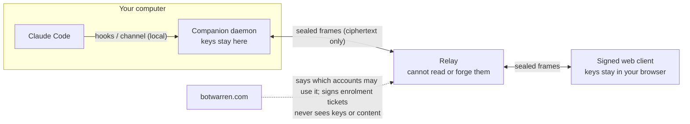

# Botwarren Companion

[](https://github.com/turbokast/botwarren-companion/actions/workflows/ci.yml)
[](https://github.com/turbokast/botwarren-companion/actions/workflows/codeql.yml)
[](https://scorecard.dev/viewer/?uri=github.com/turbokast/botwarren-companion)
[](https://github.com/turbokast/botwarren-companion/releases)
[](LICENSE)

Opt-in, end-to-end encrypted **remote approvals** for your coding agents. From your own paired phone or browser you can see when an agent is waiting for you, read its pending question or permission request and its last few messages, and answer with **approve, deny or a preset reply**. Nothing else: no free text, no terminal output, no tool output, no files.

This repository is the whole thing: the program that runs on your computer (the **companion**), the **relay** that carries encrypted messages between your computer and your devices, and the **web client** you answer from. The [Botwarren](https://botwarren.com) website and hosted service are separate and are not part of it.

It is a **separate program** from the metadata-only [Botwarren ship agent](https://github.com/turbokast/botwarren-ship). The ship agent's promise (it never reads your prompts, code or output) stays literally true. This program does read your agent's own words on your computer, which is exactly why it is separate, off by default, and open source.

> Status: pre-release (0.1.x). Offered only to accounts that were explicitly enabled and have agreed. **No independent security review has been done yet.** That is an accepted risk, and it is why you should read the next section before turning it on.

## How it works



1. The companion on your computer holds a signing key and an encryption key. Your phone or browser holds its own keys, created when you pair it, kept as non-extractable browser keys.
2. Every message between them is encrypted to the receiving device's key (HPKE, RFC 9180) and signed by the sender (Ed25519). The relay forwards opaque, size-padded frames and keeps nothing durable (a short in-memory queue, 15 minutes at most).
3. Pairing uses a one-time code shown **on your computer** (text and QR). You confirm on the computer that the six-digit check matches the one on the phone. Nothing is paired from the website.
4. When Claude Code asks you something, the companion tells your devices. When you answer, the companion checks the answer against the request that is pending *right now*, and only then delivers it.

## The security model, in plain words

* **The relay and the Botwarren website cannot read your messages and cannot forge one.** They carry ciphertext. They never hold a device key.
* **The server cannot read it unless we serve you malicious code.** The web page you answer from is served by Botwarren (from the relay's own cookie-less origin). It is built reproducibly from this repository, signed with the Botwarren component signing key (a non-exportable Google Cloud KMS key, separate from the key that signs the ship agent's updates, that only this repository's release workflow can use) and checked by a small loader before it runs. If our servers were taken over, they could serve you different code that reads what you see and approves requests. Signing lets a reviewer detect that; it does not stop it for you in the moment. A native app or a browser extension would remove this caveat, and is on the path ([docs/CLIENT_SECURITY.md](docs/CLIENT_SECURITY.md)).
* **What a bad client can do is limited by your computer, not by the client.** The companion accepts exactly three actions (approve, deny, a preset reply from a list on your computer), only for a request that is pending now and only if it matches what the device displayed (a hash of the request is echoed back). The words delivered to the agent are never the client's. There is a rate limit, a pause switch, a per-device revoke and optional "confirm on this computer" for approvals and replies.
* **What the companion reads:** the agent's pending question or permission request (already masked by Claude Code), and the last three assistant messages (600 characters each) from the session transcript, masked for token-shaped strings before encryption. Never tool output, never the terminal, never your prompts.
* **No external security review yet.** The cryptography is standard primitives from WebCrypto, checked against the RFC test vectors, and the code is small. But nobody independent has reviewed the design or the code, and this README will not pretend otherwise. We will say so here until it has happened.
* **Metadata is visible to the relay operator:** connection times and addresses (transient), key-derived ids, a pseudonymous account tag, the device labels you chose, message counts and size buckets. The full table is in [docs/PROTOCOL.md](docs/PROTOCOL.md) section 9.

The protocol, the threat model (T1 to T12) and the accepted risks are in [docs/PROTOCOL.md](docs/PROTOCOL.md). Report a weakness privately: [SECURITY.md](SECURITY.md).

## Install and pair

The Companion is not installed by default. There are two ways to get it onto a computer, and both install **only** a bundle that passed the same checks: the Ed25519 signature of the component manifest (checked first) against the Botwarren component signing key, then the bundle's size and SHA-256, then its contents, and only then a self-test. The component key is a separate key from the one that signs the ship agent's own updates; it is pinned separately, and neither key is ever accepted for the other's job. If any check fails, nothing is installed and nothing from the download runs. Every release here publishes the signed bundle (`companion-<version>.zip`), the signed manifest, the installers and their hashes.

* **With the Botwarren ship agent** (0.7.1 or later for the commands below): the agent installs it when **your account has been offered it and you agreed** on your account page at botwarren.com (`botwarren companion status | remove | block`). The agent adds a `botwarren-companion` command next to `botwarren`, and every command below also works as `botwarren companion <command>`.
* **Without a ship agent** (see below): run the installer yourself.

### Install without a ship agent

For a computer that does not run the ship agent (for example a development machine that runs from source, or one where you prefer not to run an agent). It needs Node.js 22.13 or newer, no administrator rights, and an account that an admin enabled for remote approvals and that agreed on the account page (without that the website will not enrol the computer, so an install on its own does nothing).

```
# Linux and macOS (add `-s -- --service` to also run it in the background):
curl -fsSL https://downloads.botwarren.com/companion/install.sh | sh
# Windows PowerShell: download, read, run
Invoke-WebRequest https://downloads.botwarren.com/companion/install.ps1 -OutFile install.ps1
.\install.ps1 --service
```

The script is [`apps/companion/install/install.sh`](apps/companion/install/install.sh) (and `install.ps1`), generated from one reviewed program ([`installer.mjs`](apps/companion/install/installer.mjs)) and attached, with a build attestation, to every GitHub release; read it before you run it if you like (`sh install.sh --help`, `--dry-run` verifies everything and writes nothing). The key it trusts is written inside it; it downloads only `manifest.json`, `manifest.json.sig` and the zip from `downloads.botwarren.com/companion/` (https only), refuses a manifest that is expired, older than one it accepted before, for another component or blocked, extracts exactly four named files into `~/.local/share/botwarren-companion` (Windows: `%LOCALAPPDATA%\Botwarren\companion`), and adds the `botwarren-companion` command to `~/.local/bin` (Windows: `%LOCALAPPDATA%\Botwarren\bin`, added to your user PATH). Re-run it to update; `--uninstall` revokes your devices, removes the hooks, deletes this computer's keys and removes everything it installed.

Then, once:

```
botwarren-companion enroll      # prints this computer's PUBLIC key; paste it on botwarren.com/account ("Remote approvals" > "Enrol a computer"), paste the enrolment text back here
botwarren-companion daemon      # leave it running (or install with --service so a service manager does)
```

1. Agree on your account page (an admin must have offered it to the account first).
2. On your computer, run the companion's `pair` command (below). A code and a QR appear **there**, never on the website.
3. Open the link or type the code on your phone, compare the six digits, and answer `y` on the computer.

```
botwarren-companion pair                      # a code and QR appear HERE; open the page, type the code, compare the six digits, answer y
botwarren-companion claude register-channel   # prints how to register the Claude Code channel (research preview) and the launch flag
botwarren-companion claude install-hooks      # shows a diff, asks, backs up, adds fail-open hooks
botwarren-companion status | devices | pause | resume | log
botwarren-companion devices revoke <name>
botwarren-companion uninstall --purge         # revokes devices, stops the daemon, removes hooks, deletes keys
```

`botwarren-companion` is the command the installer (or the ship agent) puts next to your other commands; it stands for `node companion.mjs` from the installed bundle (the same file the zip contains), or `pnpm --filter @botwarren/companion cli` in a checkout. With the ship agent, `botwarren companion pair` (and `devices`, `status`, `pause`, `resume`, `confirm`, `log`, `claude ...`) is the same thing; remove an agent-installed companion with `botwarren companion remove`, not `uninstall`.

### Claude Code requirements

* **Answering from your phone uses Claude Code Channels**, which is a Claude Code **research preview** and may change. It needs Claude Code 2.1.234 or later, a claude.ai login, and on Team or Enterprise plans an organisation owner must enable channels. Sessions are started with the channel flag that `claude register-channel` prints (an unlisted channel is loaded with the development flag until it is on the vendor's allow-list). With a channel, the terminal dialog stays open and whichever of the terminal and your phone answers first wins.
* **Without Channels** the companion still tells you that an agent is waiting (hooks: `PermissionRequest`, `Notification`, `Stop`), but it does not hold the terminal: `holdSeconds` is 0 by default. Whether a held hook leaves the terminal dialog usable is not documented; `botwarren-companion claude doctor` runs the live checks.
* The companion never edits Claude Code settings silently: `install-hooks` shows the diff, backs the file up and marks exactly what it added so `uninstall-hooks` removes only that.
* Codex and Ninox are designed for (the `AgentBridge` interface) but not supported yet.

Defaults: `deny` always works remotely; `approve` and preset replies work remotely for an enrolled user, each switchable to "always confirm on this computer" in `config.json`.

## Layout

| Path | What |
|---|---|
| `apps/companion/src/protocol/` | the shared protocol library (browser, relay, daemon): crypto, envelope, pairing, certificates, message schemas |
| `apps/companion/src/` | the daemon core (`host.ts`, `sessions.ts`, `policy.ts`, `mask.ts`), the relay connection (`link/`), the Claude Code bridge (`claude/`: hooks and the MCP channel server), the local socket, the `botwarren-companion` CLI |
| `apps/companion/client/` | the web client: verifying loader, app, build and signing scripts |
| `apps/companion/scripts/` | release tooling: build the component, finalise and verify manifests, package the relay image inputs, verify a release |
| `apps/companion/vendor/agent/` | verbatim copies of the few ship agent files the release tooling shares (the pinned public keys, manifest schema and verifier, archive writer, KMS client, component signer) |
| `apps/relay/` | the relay: WebSocket frame forwarding, pairing rendezvous, rate limits, kill switches, static hosting of the signed client |
| `deploy/Dockerfile.relay` | the relay image, built from a release's relay image inputs ([docs/RELAY.md](docs/RELAY.md)) |
| `docs/` | [PROTOCOL.md](docs/PROTOCOL.md), [CLIENT_SECURITY.md](docs/CLIENT_SECURITY.md), [RELAY.md](docs/RELAY.md), [RELEASING.md](docs/RELEASING.md), [REPO_SETTINGS.md](docs/REPO_SETTINGS.md) |

## Develop

Node.js 22.18 or newer (the sources run directly with type stripping; `.nvmrc` says 24, which CI and releases use) and pnpm 11 (`corepack enable`).

```
pnpm install
pnpm typecheck
pnpm test        # protocol vectors (RFC 9180, 8032, 5869), tamper and replay, the relay, an end-to-end run with a simulated phone, release tooling
pnpm test:e2e    # the signed web client in a real browser (needs: pnpm --filter @botwarren/companion exec playwright install chromium)
```

On a busy machine run one test file at a time (`pnpm --filter @botwarren/companion exec vitest run test/e2e.test.ts`); the integration tests open loopback sockets and use real timers.

## Verify a release

Releases are built by [a public workflow](.github/workflows/release.yml) from a `v*` tag on `main`, built twice independently (the hashes must match), signed in a protected GitHub environment with the Botwarren component signing key through GitHub OIDC (no stored credential), and attested with GitHub build provenance. To check one you downloaded:

```
gh attestation verify relay-context-<version>.tar.gz --repo turbokast/botwarren-companion
node apps/companion/scripts/verify-release.mjs <directory with the release files>
```

The second command trusts only the public component key pinned in this repository (`kms-comp-2026a`): it checks `SHA256SUMS`, the client signature and every client file, the component signature and the bundle it describes, and that the relay image inputs hold exactly the signed client. More in [docs/RELEASING.md](docs/RELEASING.md).

## Contributing, support, governance

[CONTRIBUTING.md](CONTRIBUTING.md) (sign off your commits: DCO), [SUPPORT.md](SUPPORT.md), [GOVERNANCE.md](GOVERNANCE.md), [CODE_OF_CONDUCT.md](CODE_OF_CONDUCT.md), [MAINTAINERS.md](MAINTAINERS.md). Security reports: [SECURITY.md](SECURITY.md).

## Licence

[Apache-2.0](LICENSE). Copyright 2026 TurboKast Ltd. "Botwarren" and "TurboKast" are names of TurboKast Ltd; the licence does not grant use of the names beyond describing where the software comes from ([NOTICE](NOTICE)).
